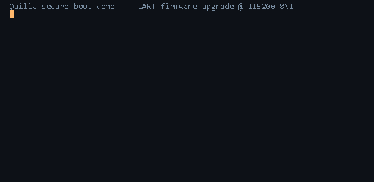

# Quilla

<p align="center">
  <a href="LICENSE.md"></a>
  <a href="https://github.com/contiki-ng/contiki-ng"></a>
  
  
  
</p>
<!-- Repo-dependent badges below: replace `jichiren/quilla` with the real GitHub OWNER/REPO once the repo exists. -->
<p align="center">
  <a href="https://github.com/jichiren/quilla/actions"></a>
  <a href="https://quilla.readthedocs.io"></a>
  
</p>

**English** · [中文](README.zh-CN.md)

Quilla is a lightweight, **secure-boot–capable, OTA-ready** embedded operating system for resource-constrained microcontrollers, derived from [Contiki-NG](https://github.com/contiki-ng/contiki-ng). It keeps the simplicity of Contiki's protothread process model and adds a dual-partition bootloader, **Ed25519 verified secure boot**, and observability facilities — so product firmware can be developed quickly *and* ship with controlled security properties.

It targets cost-effective **Arm Cortex-M and RISC-V** microcontrollers that mainstream RTOSes rarely support out of the box. Two Arm positioning profiles are ported today — the **ultra-low-power entry** profile (PY32F040xB, Cortex-M0+) and the **security-rich** profile (GD32F502VE, Cortex-M33), spanning the low end and the TrustZone-equipped mainstream of the Cortex-M class. A first RISC-V bring-up (CH32V305VB, WCH QingKe V4F core, RV32IMAC) also builds end-to-end with the GNU GCC12 / EIDE toolchain but is **not yet on-target verified**; the pin- and peripheral-compatible CH32V307 in the same CH32V30x family adds a 1 G MAC + 10 M PHY for networked products, making a RISC-V networking SKU a quick derivative port. Additional Arm Cortex-M parts remain to be ported.

<p align="center">
  
</p>

## Why Quilla

- **Secure boot & anti-rollback**
  - RFC 8032 Ed25519 image verification, SHA-256 integrity, and a version floor. Three build variants: `QBOOT_CHECK` (SHA-256 only, no key), `QBOOT_SEALED` (seal fast-path, ~0.6 s on PY32F040xB), `QBOOT_SEC` (full Ed25519 every boot).
  - The public key is compiled into QBOOT; the private key stays offline at the signing station and never enters the firmware or the repository.
- **Native OTA (QIAP)**
  - Ships with a dual-partition bootloader out of the box: QBOOT (bootloader) + APP. The APP is upgraded over UART from a host tool in one step — no dedicated programmer required.
  - Upgrades use a flag + manifest handshake that is power-loss resumable; on the APP side only a `swqboot` command and a partition marker need to be exposed.
- **Lightweight, deterministic kernel**
  - A cooperative protothread process model with no preemptive multithreading; driven by a single rtimer hardware IRQ for high-precision timing, so the scheduling path is deterministic.
  - Zero dynamic memory allocation in the kernel (heap disabled by design), eliminating a whole class of heap-related failures at the mechanism level.
- **Observability & safety infrastructure**
  - Stack watermark monitoring (kern-stack), unified status codes (kern_status_t), and low power (lpm, PM0/PM1).
  - Control-flow sequence monitoring (kern-flow): checkpoints are placed in the idle loop to detect control-flow faults and transition to a safe state on anomaly.
  - A companion independent watchdog (qwdt, with timeout bounds) and clock cross-check (qclk, detecting LSI unlock).
- **CMSIS-Pack layout, multi-MCU / multi-architecture**
  - A CMSIS-Pack–compliant directory layout; APP code is decoupled from the MCU behind a single public API, so changing silicon — even across CPU architectures (Cortex-M ↔ RISC-V) — requires no changes to the application layer.
- **Voluntary alignment to safety-related standards (no third-party certification submitted)**
  - The development process voluntarily adopts key practices from safety-related standards such as IEC 61508 / ISO 26262 — change control, locked toolchain, MISRA-C checks, independent review, reproducible builds.
  - **No third-party certification body has been engaged**: the safety analysis and assurance-level conclusions in this repository represent internal assessment only and do not constitute a certification claim.

## Supported hardware

| MCU | Core / Clock | Flash / SRAM | Status |
| --- | --- | --- | --- |
| PY32F040xB | Cortex-M0+ @ 48 MHz | 128 KB / 16 KB | On-target verified |
| GD32F502VE | Cortex-M33 @ 160 MHz | 512 KB / 64 KB | On-target verified (QBOOT_CHECK / QBOOT_SEC) |
| CH32V305VB | RISC-V / QingKe V4F (RV32IMAC) @ 96 MHz | 128 KB / 32 KB | Build verified (GCC12 / EIDE); on-target pending |

### Why these parts

The three reference ports are not a random sample — each is a **low-cost chip with a distinct focus**, covering differentiated position tiers across the Cortex-M / RISC-V landscape; delivering secure boot and OTA on such production-grade commodity MCUs while spanning Cortex-M and RISC-V to prove the secure-boot / OTA stack is portable across ISAs and not vendor-locked is precisely Quilla's design objective:

- **PY32F040xB (Cortex-M0+)** — an ultra-cheap, widely sourced entry-class part. Its minimal peripheral set and tiny SRAM define the minimal viable footprint, proving the OS runs on the smallest realistic target and keeping the port simple.
- **GD32F502VE (Cortex-M33)** — the security-rich mainstream. TrustZone-M, generous Flash/SRAM and broad market acceptance make it the natural reference for the secure-boot and isolation story without resorting to an exotic or premium part.
- **CH32V305VB (WCH QingKe V4F, RISC-V RV32IMAC)** — a mainstream, general-purpose RISC-V offered at a Cortex-M price. Its decisive edge in the same bracket is **low cost with USBHS and industrial-temperature support**; the pin- and peripheral-compatible CH32V307 adds a 1 G MAC + 10 M PHY for networked products, so a RISC-V networking SKU is a quick derivative port.

All three are low-cost parts yet each targets a distinct product direction — which is exactly why they serve as the canonical examples for the porting guidance.

## Quick start

Build the bootloader with the GNU `arm-none-eabi` toolchain (per-MCU makefiles under `user/<mcu>/EIDE/`, or the Keil projects under `user/<mcu>/MDK-ARM/`), then flash the APP over UART:

> The RISC-V **CH32V305VB** port builds only with the WCH RISC-V Embedded GCC12 toolchain under `user/ch32v305rb/EIDE/` (EIDE/GNU only, no Keil) — see [`doc/riscv-ch32v305-build.md`](doc/riscv-ch32v305-build.md).

```bash
# Flash an APP image over the serial port (QBOOT must be present on target)
python tools/quilla_host_upgrader.py <COM> app.bin -b 115200

# Generate your own keypair and sign an image (replace the in-repo sample key before shipping)
python tools/quilla_ed25519_sign.py keygen
python tools/quilla_ed25519_sign.py sign --key private.hex app.bin
```

See [`doc/keil-qboot-app-build.md`](doc/keil-qboot-app-build.md) for full build steps and [`doc/quilla-host-upgrader-guide.md`](doc/quilla-host-upgrader-guide.md) for the upgrade tool.

## Documentation

Entry point and reader navigation: [`doc/Home.md`](doc/Home.md) (English) ·
[`doc/Home.zh-CN.md`](doc/Home.zh-CN.md) (中文).

- **Application developers** (architecture / protocols / secure boot / flows / API contract):
  `doc/qboot-app-architecture.md`, `doc/secure-boot.md`, `doc/boot-flow.md`, `doc/upgrade-flow.md`,
  `doc/quilla-host-upgrader-guide.md`, `doc/app-api-reference.md`
- **Porters / APP developers** (MCU adaptation / calling OS APIs):
  `doc/port-layout.md`, `doc/cmsis-layout.md`, `doc/keil-qboot-app-build.md`

## License & attribution

Quilla is derived from Contiki-NG. Unless explicitly stated otherwise, sources are distributed under the [3-clause BSD license](LICENSE.md), retaining the upstream copyright notice; derived files also carry `Copyright (c) 2026, JiChiRen Info. Tech.`

The original upstream README is preserved as [`CONTIKI-README.md`](CONTIKI-README.md) for Contiki-NG attribution and reference.
