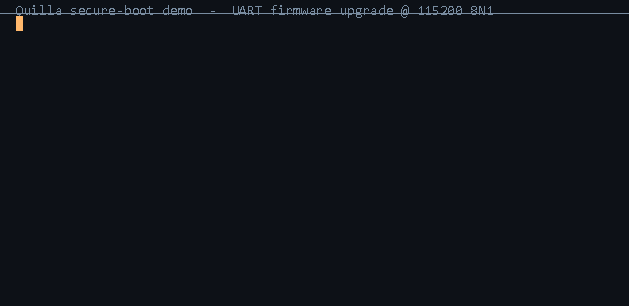

# Quilla

<p align="center">
  
</p>

<p align="center">
  <a href="LICENSE.md"></a>
  <a href="https://github.com/contiki-ng/contiki-ng"></a>
  
  
  
</p>
<p align="center">
  <a href="https://github.com/JiChiRen/Quilla/actions/workflows/build.yml"></a>
</p>

**中文** · [English](README.md)

Quilla 由**机器人组件及光通信设计公司——深圳市积器仁信息有限公司（JiChiRen Info）**的开源办公室（OSPO）维护。它脱胎于积器仁量产项目中实际使用的信息安全固件系统：剥离业务内容后，为开源重新适配了 3 个 Demo MCU，作为对开源社区的回馈。同一套代码已用于远程信息安全组件等工业项目，以及密码门锁等消费电子项目。

公司网站：[https://www.jichiren.com](https://www.jichiren.com)

Quilla 是一套面向资源受限 MCU 的**轻量级、可安全启动、原生支持固件升级**的嵌入式操作系统，派生自 [Contiki-NG](https://github.com/contiki-ng/contiki-ng)。它在保留 Contiki 协程（protothread）进程模型简洁性的基础上，构建了双分区引导、安全启动与可观测性设施，目标是让产品级固件既能快速开发，又具备可控的安全属性。

Quilla 针对低资源微控制器上开源信息安全系统相对稀缺的现状，提供了一套内建安全启动与认证式 OTA 的轻量方案。目前已移植两类 Arm 定位档位——**超低功耗入门档**（PY32F040xB，Cortex-M0+）与**带安全扩展的主流档**（GD32F502VE，Cortex-M33），覆盖了 Cortex-M 家族从低端到带 TrustZone 的主流区间；另有一个 RISC-V 首版移植（CH32V305VB，WCH 青稞 QingKe V4F 内核，RV32IMAC）已用 GNU GCC12 / EIDE 全程构建通过，但**尚未上板实测**；同系列引脚与外围兼容的 CH32V307 带 1G MAC + 10M PHY，可快速衍生网络产品移植。更多 Arm Cortex-M 型号待适配。

<p align="center">
  
</p>

## 系统特点

- **安全启动与防回滚**
  - 基于 RFC 8032 Ed25519 的镜像验签、SHA-256 完整性、版本地板。三种构建变体：
    - `QBOOT_CHECK`——仅 SHA-256 完整性（无钥匙）；
    - `QBOOT_SEALED`——seal 快路径（已验证镜像跳过完整验签，PY32F040xB 上 ~0.6 s）；
    - `QBOOT_SECURED`——每次启动都完整 Ed25519 验签。
  - 公钥编译进 QBOOT，私钥离线留存于签名工位，绝不进入固件或仓库。

- **原生可升级（QIAP）**
  - 出厂即内置双分区引导：QBOOT（bootloader）+ APP。APP 可通过串口由上位机工具一键升级，无需专用烧录器。
  - 升级采用"标志 + manifest"握手，掉电可恢复；APP 侧仅需暴露 `swqboot` 命令并标记分区标识。

- **轻量且确定性的内核**
  - 基于协程（protothread）的进程模型，无抢占式多线程；仅依赖单个 rtimer 硬件中断驱动高精度定时，调度路径确定。
  - 内核零动态内存分配（禁堆），从机制上排除堆相关一类失效。

- **可观测与安全基础设施**
  - 栈水印监控（kern-stack）、统一状态码（kern_status_t）、低功耗（lpm，PM0/PM1）。
  - 程序流序列监控（kern-flow）：在 idle 循环布检查点，探测控制流故障，异常即转入安全态。
  - 配套独立看门狗（qwdt，带超时边界）与时钟交叉校验（qclk，检测 LSI 失锁）。

- **规范化的工程布局与多 MCU / 多架构支持**
  - 遵循 CMSIS-Pack 规范的目录布局；APP 代码通过统一公开 API 与 MCU 解耦，换芯甚至跨 CPU 架构（Cortex-M ↔ RISC-V）都无需改动应用层。

- **自愿对标安全相关标准（未送第三方认证）**
  - 开发过程自愿参照 IEC 61508 / ISO 26262 等安全相关标准的关键实践——变更受控、工具链锁定、MISRA C 机检、独立审查、可复现构建。
  - **当前未提交任何第三方认证机构**：本仓库中的安全分析与等级结论仅代表内部评估，不构成认证声明。

## 支持硬件

| MCU | 内核 / 主频 | Flash / SRAM | 状态 |
| --- | --- | --- | --- |
| PY32F040xB | Cortex-M0+ @ 48 MHz | 128 KB / 16 KB | 已上板实测 |
| GD32F502VE | Cortex-M33 @ 160 MHz | 512 KB / 64 KB | 已上板实测（QBOOT_CHECK / QBOOT_SECURED） |
| CH32V305VB | RISC-V / 青稞 QingKe V4F (RV32IMAC) @ 96 MHz | 128 KB / 32 KB | 编译验证（GCC12 / EIDE）；待上板 |

### 为什么选这三颗芯片

三个参考移植并非随意取样——它们都是**低成本、但侧重方向各异**的芯片，分别覆盖 Cortex-M / RISC-V 版图上的差异化定位档位；在量产级大宗商品 MCU 上提供安全启动与 OTA，并横跨 Cortex-M 与 RISC-V 证明安全/升级栈跨指令集可移植、不依赖单一厂商，正是 Quilla 的目标定位：

- **PY32F040xB（Cortex-M0+）**——极低成本、货源广泛的入门级型号。其精简的外设与极小 SRAM 决定了最小可行 footprint，证明本系统在最小现实目标上也能跑，且让移植保持简单。
- **GD32F502VE（Cortex-M33）**——带安全扩展的主流档。TrustZone-M、充裕的 Flash/SRAM 与广泛的市场接受度，使其成为安全启动与隔离叙事的自然参考，又无需跳到 exotic 或高价型号。
- **CH32V305VB（WCH 青稞 QingKe V4F，RISC-V RV32IMAC）**——以 Cortex-M 的价位提供的通用 RISC-V。其在同等价位中最突出的优势是**低成本下的 USBHS 与工业级温度支持**；引脚与外围兼容的 CH32V307 进一步提供 1G MAC + 10M PHY，可快速衍生网络产品 SKU——因此一颗 RISC-V 网络型号只是快速的派生移植。

三颗芯片均立足低成本、却各自覆盖一个差异化的产品方向，这正是它们被选为移植指南范例的原因。

## 快速开始

用 GNU `arm-none-eabi` 工具链构建 bootloader（每 MCU 的 makefile 在 `user/<mcu>/EIDE/`，Keil 工程在 `user/<mcu>/MDK-ARM/`），再经串口烧录 APP：

> RISC-V **CH32V305VB** 移植仅用 WCH RISC-V Embedded GCC12 工具链在 `user/ch32v305rb/EIDE/` 下构建（仅 EIDE/GNU，无 Keil）——见 [`doc/riscv-ch32v305-build.zh-CN.md`](doc/riscv-ch32v305-build.zh-CN.md)。

```bash
# 通过串口烧录 APP 镜像（目标须已烧 QBOOT）
python tools/quilla_host_updater.py <COM> app.bin -b 115200

# 生成自有密钥对并签名镜像（量产前须替换仓库内的示例公钥）
python tools/quilla_ed25519_sign.py keygen
python tools/quilla_ed25519_sign.py sign --key private.hex app.bin
```

完整构建步骤见 [`doc/keil-qboot-app-build.md`](doc/keil-qboot-app-build.md)，升级工具见 [`doc/quilla-host-updater-guide.md`](doc/quilla-host-updater-guide.md)。

> **想要图形化工具？** [`QuillaUpdater`](https://github.com/JiChiRen/QuillaUpdater) 是同一套 QIAP 升级流程的独立 Tk 图形上位机（命令行 `quflash` 同引擎）——选串口、选 `.bin`、点开始；带预检、可协作取消、中英双语。Python 3.8+，仅依赖 `pyserial`，无需 Qt/Node/安装包。

## 文档

入口与读者导航：[`doc/Home.md`](doc/Home.md)（English）· [`doc/Home.zh-CN.md`](doc/Home.zh-CN.md)（中文）。

- **应用开发者**（整体功能 / 架构 / 协议 / 安全启动 / 流程 / 接口契约）：
  `doc/qboot-app-architecture.md`、`doc/secure-boot.md`、`doc/boot-flow.md`、`doc/upgrade-flow.md`、
  `doc/quilla-host-updater-guide.md`、`doc/app-api-reference.md`
- **移植者 / 应用开发者**（MCU 适配 / APP 调用 OS API）：
  `doc/port-layout.md`、`doc/cmsis-layout.md`、`doc/keil-qboot-app-build.md`
- **编码规范**（Quilla 自有代码遵循的 MISRA C:2012 规则与排除范围）：
  [`doc/coding-guidelines.md`](doc/coding-guidelines.md)

## 许可与归属

Quilla 派生自 Contiki-NG。除非显式声明，源代码在原 **3-clause BSD license** 下分发，并保留上游版权声明；派生源另含 `Copyright (c) 2026, JiChiRen Info. Tech.`。完整许可见 [`LICENSE.md`](LICENSE.md)。

原始上游 README 已备份为 [`CONTIKI-README.md`](CONTIKI-README.md)，供查阅 Contiki-NG 原始说明与归属信息。
